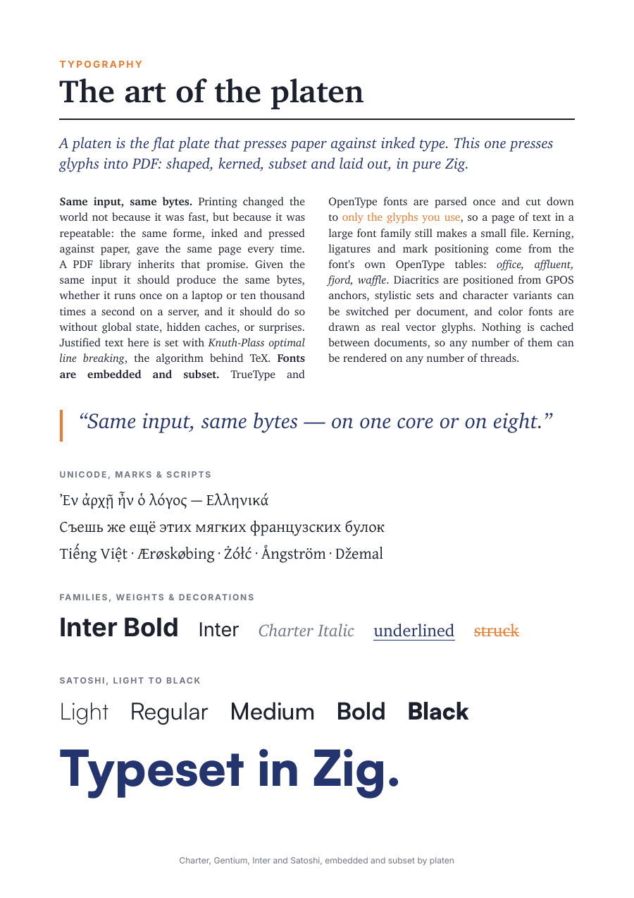
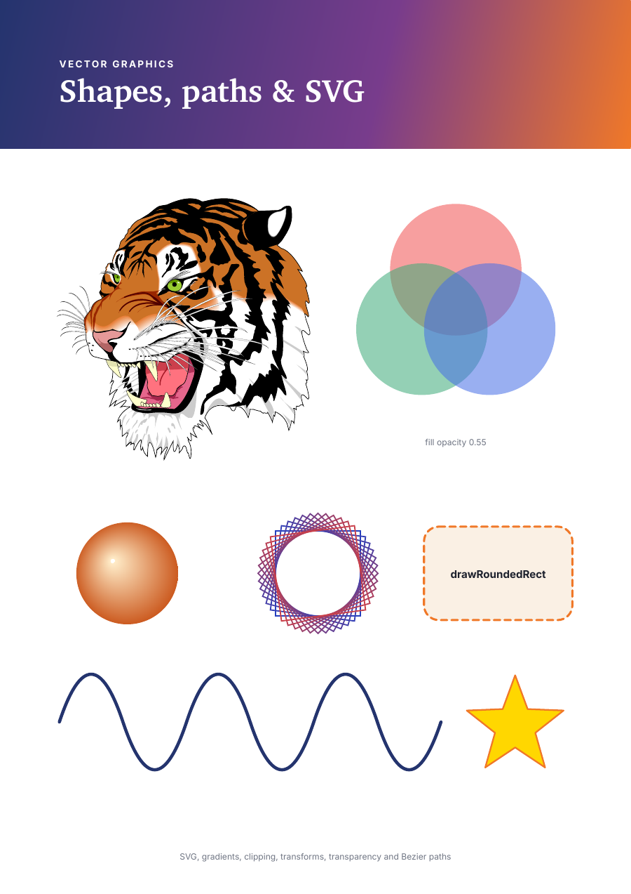
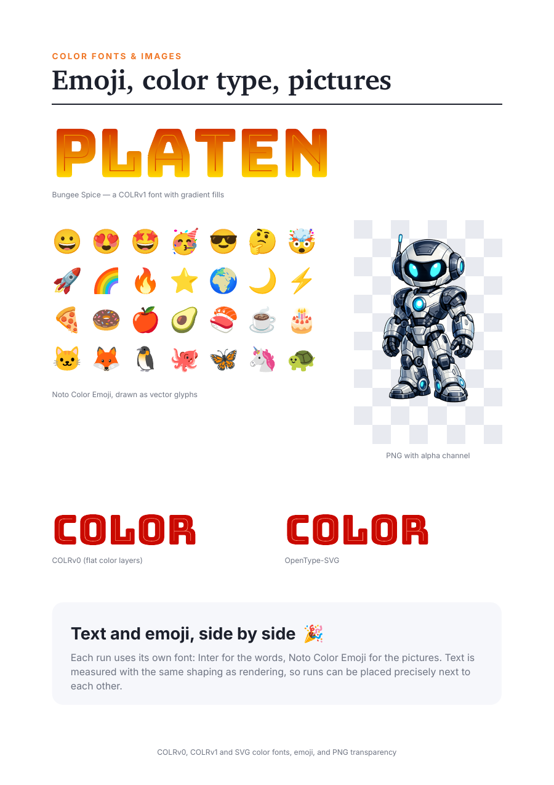
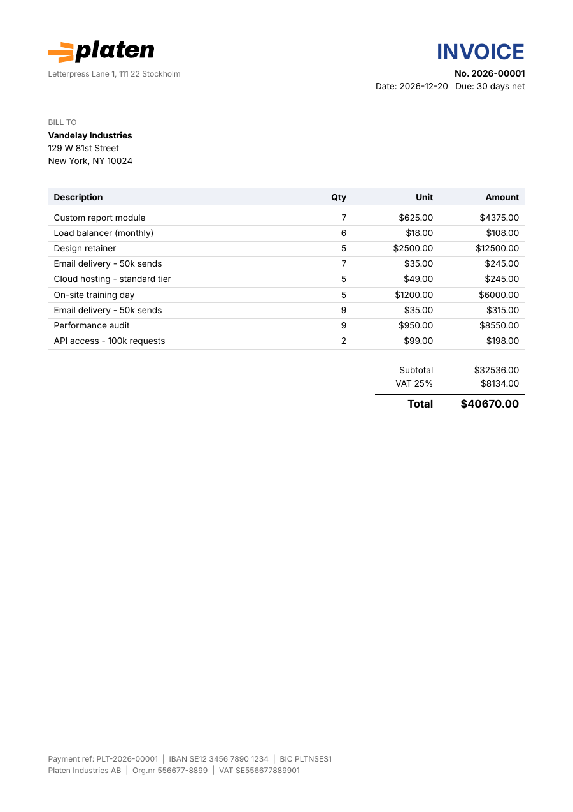

<p align="center">
  
</p>

A fast, self-contained PDF generation library written in Zig. Supports text layout, TrueType/OpenType font embedding, color emoji fonts, images, vector graphics, and PDF/A archival output. Pure Zig — no dependencies at all.

## Gallery

Every page below is a PDF rendered by platen; click an image to open the PDF itself.

<table>
  <tr>
    <td align="center" width="25%">

[](examples/showcase_typography.pdf)

<sub><b>Typography</b><br>Knuth-Plass justification, OpenType shaping, Unicode marks</sub>
</td>
    <td align="center" width="25%">

[](examples/showcase_graphics.pdf)

<sub><b>Vector graphics</b><br>SVG, gradients, clipping, transforms, opacity</sub>
</td>
    <td align="center" width="25%">

[](examples/showcase_color.pdf)

<sub><b>Color fonts &amp; images</b><br>COLRv0/v1, OT-SVG, emoji, PNG alpha</sub>
</td>
    <td align="center" width="25%">

[](examples/benchmark_invoice.pdf)

<sub><b>Invoice</b><br>~17,700 per second on 8 cores (<a href="#many-small-documents-invoice-throughput">benchmark</a>)</sub>
</td>
  </tr>
</table>

The first three are made by [`src/showcase.zig`](src/showcase.zig) (`zig build showcase` writes `examples/showcase_*.pdf`); the invoice is the [invoice benchmark](src/invoice_bench.zig)'s sample. `scripts/render-readme-images` regenerates all four images.

## Features

- **Text rendering** with standard PDF fonts (Helvetica, Times, Courier, Symbol, ZapfDingbats)
- **TrueType/OpenType font embedding** with automatic subsetting
- **Unicode via CID fonts** (Latin, Greek, Cyrillic, CJK glyphs, emoji; see [Limitations](#limitations))
- **OpenType features**: ligatures, kerning (GPOS, or a legacy `kern` table), mark positioning, stylistic sets, character variants, and more
- **Color fonts**: COLR v0/v1 (layered, gradients, sweep gradients), sbix/CBDT/EBDT bitmap strikes, and OT-SVG — full color emoji support
- **Text flow**: word wrapping, justified text, Knuth-Plass optimal line breaking
- **Graphics**: lines, rectangles, circles, ellipses, polygons
- **Path API**: moveTo, lineTo, curveTo, quadTo for custom shapes
- **Images**: JPEG and PNG embedding (with alpha channel support)
- **SVG embedding**: shapes, paths, text, gradients, transforms, `<use>`/`<defs>`, colors in any CSS Color 4 syntax
- **Transforms**: translate/rotate/scale with graphics-state push/pop; page rotation
- **Clipping**: rectangle and path clipping
- **Gradients**: linear and radial
- **Transparency**: fill/stroke opacity for shapes and fill opacity for text
- **Document metadata**: title, author, subject, keywords
- **Links**: internal (TOC navigation) and external (URLs)
- **PDF/A conformance**: PDF/A-1b and PDF/A-2b archival formats (VeraPDF validated)
- **Encryption**: AES-256 (PDF 2.0 / security handler R6), password + permissions
- **Compression**: FlateDecode for smaller file sizes

## Performance

Two benchmarks on an Apple M1 Pro (8 cores, release build; medians of 3 runs, measured 2026-10-06), measuring different workloads: one large document, and many small documents.

### One large document

110 pages in five 20-page sections — simple text, OpenType shaping (ligatures/kerning), Unicode with diacritics, justified text flow, vector graphics (~1500 shapes/page) — plus 10 pages of color emoji. [See the generated document](examples/benchmark_110pages.pdf) (621 KB). Run it with `zig build perf -Doptimize=ReleaseFast`.

| Operation | Time |
|-----------|------|
| Font loading | <1ms |
| Simple text | 2ms |
| OpenType shaping | 11ms |
| Unicode/marks | 4ms |
| Text flow | 2ms |
| Drawing shapes | 13ms |
| Color emoji | 3ms |
| PDF output | 33ms |
| **Total** | **70ms** (~1570 pages/sec) |

Setting `doc.compress_threads = 8` compresses streams (page contents, font subsets) on worker threads during `output()`: PDF output drops to 18ms and the total to ~54ms on the same hardware, with byte-identical output. Requires a thread-safe allocator.

### Many small documents (invoice throughput)

1000 unique single-page A4 invoices, generated one complete PDF at a time (single-threaded): 3-10 line items each, embedded Inter regular + bold with full OpenType shaping, the platen wordmark as vector SVG, per-document font subsetting. [See a generated sample](examples/benchmark_invoice.pdf). Run it with `zig build bench-invoice -Doptimize=ReleaseFast`.

| Mode | Latency | Throughput |
|------|---------|------------|
| Uncompressed, 1 thread | 0.48ms | ~2,060 PDFs/sec |
| Uncompressed, 1 thread, shared assets | 0.30ms | ~3,350 PDFs/sec |
| Uncompressed, 8 threads | 0.11ms | ~9,500 PDFs/sec |
| Uncompressed, 8 threads, shared assets | 0.06ms | **~17,700 PDFs/sec** |
| Compressed (level 1), 1 thread | 0.90ms | ~1,100 PDFs/sec |

By default every document pays the full stateless cost: fonts are re-parsed, shaped, and subset per PDF, and the SVG is re-parsed per PDF. **Shared assets** (`--shared` in the benchmark) parse fonts and SVGs once via caller-owned `FontFace`/`Svg` and reuse them across documents and threads — output stays byte-identical.

Because documents share no state, they can be rendered concurrently without locking — one `Document` per thread scales close to linearly across cores (`--threads=N` in the benchmark). A single `Document` is not thread-safe; keep each document on one thread.

See [PERFORMANCE.md](PERFORMANCE.md) for optimization details.

## Quick Start

```zig
const std = @import("std");
const platen = @import("platen");

pub fn main(init: std.process.Init) !void {
    const allocator = init.gpa;

    // Create document. `init.io` is used for any file I/O the document
    // performs (loadFont/loadImage/loadSvg). In tests, pass `std.testing.io`.
    var doc = platen.Document.init(allocator, init.io);
    defer doc.deinit();

    // Add a page and write text
    try doc.addPage(.{});
    const style = platen.TextStyle{ .font = platen.Font.helvetica, .size = 24 };
    _ = try doc.writeAt(.{ .x = 50, .y = 50 }, "Hello, World!", style, .{});

    // Save to file
    const pdf_data = try doc.output();
    defer allocator.free(pdf_data);

    try std.Io.Dir.cwd().writeFile(init.io, .{ .sub_path = "hello.pdf", .data = pdf_data });
}
```

## Coordinates & anchoring

All coordinates are in points (1/72 inch) with the origin at the **top-left**
of the page, y growing downward. Anchoring differs by content type,
following typographic convention:

- **Text** (`writeAt`): `y` is the **baseline** of the text; `opts.anchor`
  chooses which part of the text sits at `x` (`.left` default, `.center`,
  `.right` - so right-aligning a value at a column edge is
  `doc.writeAt(.{ .x = right_edge, .y = y }, text, style, .{ .anchor = .right })`).
- **Shapes and images** (`drawRect`, `drawImage`, `drawSvg`, ...): `rect.y`
  is the **top edge**.
- **Regions** (`write`, `writeBlock`, `writeStyled`): `y` is the top of the
  region; the baseline of the first line is placed from font metrics
  according to `valign`.

Every number passed to a `Document` method (coordinates, sizes, radii,
style widths, colors, opacities, transform factors) must be finite and
within ±`platen.max_value` (1,000,000). Anything else - NaN, infinity,
or a larger magnitude - returns `error.InvalidNumber` and leaves the
document unchanged. Values are never silently clamped.

## Installation

Add platen as a dependency in your `build.zig.zon`:

```zig
.dependencies = .{
    .platen = .{
        .url = "https://git.urverk.org/urverk/platen/archive/v0.10.0.tar.gz",
        .hash = "...",
    },
},
```

Or run `zig fetch --save https://git.urverk.org/urverk/platen/archive/v0.10.0.tar.gz`
to fill in the hash. Releases are tagged on `main`; see [CHANGELOG.md](CHANGELOG.md).

Then in your `build.zig`:

```zig
const platen_dep = b.dependency("platen", .{
    .target = target,
    .optimize = optimize,
});
exe.root_module.addImport("platen", platen_dep.module("platen"));
```

Or clone and build directly:

```bash
git clone https://git.urverk.org/urverk/platen.git
cd platen
zig build        # Build CLI tool
zig build test   # Run tests
```

## Usage Examples

### Text with Multiple Fonts

```zig
try doc.addPage(.{});

const title = platen.TextStyle{ .font = platen.Font.helvetica, .size = 16, .bold = true };
const body = platen.TextStyle{ .font = platen.Font.times, .size = 12 };
const code = platen.TextStyle{ .font = platen.Font.courier, .size = 10 };

_ = try doc.writeAt(.{ .x = 50, .y = 50 }, "Title", title, .{});
_ = try doc.writeAt(.{ .x = 50, .y = 80 }, "Body text in Times Roman", body, .{});
_ = try doc.writeAt(.{ .x = 50, .y = 100 }, "Monospace code", code, .{});
```

### Custom Fonts (TrueType/OpenType)

For fonts used by a single document. (To reuse a parsed font across many
documents or threads, see [Font faces](#font-faces-parse-once-use-anywhere).)

```zig
// Load a TTF or OTF font (default: identity/Unicode encoding)
const font = try doc.loadFont("fonts/MyFont.ttf", .identity);

// Or specify encoding explicitly
const latin_font = try doc.loadFont("fonts/Latin.ttf", .win_ansi);

try doc.addPage(.{});
const style = platen.TextStyle{ .font = font, .size = 14 };
_ = try doc.writeAt(.{ .x = 50, .y = 50 }, "Custom font with Unicode: 日本語 🎉", style, .{});
```

### Font Families (Bold/Italic Variants)

```zig
// Load a font family with all variants
const gentium = try doc.loadFontFamily(.{
    .regular = "fonts/Gentium-Regular.ttf",
    .bold = "fonts/Gentium-Bold.ttf",
    .italic = "fonts/Gentium-Italic.ttf",
    .bold_italic = "fonts/Gentium-BoldItalic.ttf",
});

try doc.addPage(.{});

// Use bold/italic flags - library selects correct variant automatically
const body = platen.TextStyle{ .font = gentium, .size = 12 };
const emphasis = platen.TextStyle{ .font = gentium, .size = 12, .italic = true };
const strong = platen.TextStyle{ .font = gentium, .size = 12, .bold = true };
const strong_emphasis = platen.TextStyle{ .font = gentium, .size = 12, .bold = true, .italic = true };

_ = try doc.writeAt(.{ .x = 50, .y = 50 }, "Regular text", body, .{});
_ = try doc.writeAt(.{ .x = 50, .y = 70 }, "Italic text", emphasis, .{});
_ = try doc.writeAt(.{ .x = 50, .y = 90 }, "Bold text", strong, .{});
_ = try doc.writeAt(.{ .x = 50, .y = 110 }, "Bold italic text", strong_emphasis, .{});
```

### Font Collections and System Fonts

```zig
// One face of a TrueType collection (.ttc); the document keeps a copy.
const ttc = try std.Io.Dir.cwd().readFileAlloc(io, "Helvetica.ttc", allocator, .limited(64 << 20));
defer allocator.free(ttc);
const helvetica_bold = try doc.loadFontFromCollection(ttc, 1, .identity);

// List faces, or extract one as standalone .ttf bytes.
const faces = try platen.listFaces(allocator, ttc);
defer platen.font_collection.freeFaces(allocator, faces);
const face_bytes = try platen.extractFace(allocator, ttc, 1);
defer allocator.free(face_bytes);

// Find an installed family (macOS, Linux, Windows font folders).
var georgia = try platen.findSystemFontFamily(io, allocator, "Georgia", .{
    .home = init.environ_map.get("HOME"), // adds the per-user folders
}) orelse return error.FontNotInstalled;
defer georgia.deinit(allocator); // after the document is done with the bytes
const font = try doc.loadFontFamilyFromMemory(georgia.memoryOptions(.identity).?);

// Or a single face: .data is a standalone sfnt for loadFontFromMemory.
const bold = try platen.findSystemFont(io, allocator, "Helvetica", .{ .bold = true }, .{});
```

The CLI exposes the same: `platen font-faces <file>`, `platen
extract-face <ttc> <index> <out>`, `platen find-font <family> [--bold]
[--italic] [--dir DIR]... [--out FILE]`.

### Text Flow with Word Wrapping

```zig
try doc.addPage(.{});

// Define a region for text
var region = platen.Region{
    .x = 72,
    .y = 72,
    .width = 468,  // page width minus margins
    .height = 700,
};

const text = "Lorem ipsum dolor sit amet, consectetur adipiscing elit...";
const style = platen.TextStyle{ .font = platen.Font.helvetica, .size = 11 };

// Incremental text with word wrapping (cursor advances on same line)
const result = try doc.write(&region, text, style, .{});

if (result.overflow) |_| {
    // Handle text that didn't fit
    try doc.addPage(.{});
    // ... continue with remaining text
}

// Block-based text with alignment (cursor moves to next line)
_ = try doc.writeBlock(&region, "Centered heading", style, .{ .alignment = .center });
_ = try doc.writeBlock(&region, "Right-aligned text", style, .{ .alignment = .right });

// Styled text for mixed styles within a paragraph: each span overrides
// the base style passed to writeStyled (unset fields inherit)
var st = doc.createStyledText();
defer st.deinit();
try st.append("Normal text ", .{});
try st.append("bold text ", .{ .bold = true });
try st.append("underlined text ", .{ .decoration = .{ .underline = true } });
try st.append("colored text", .{ .color = platen.Color.blue });

_ = try doc.writeStyled(&region, &st, style, .{ .alignment = .justify });
```

#### Continuing styled text in the next region

When a styled paragraph doesn't fit, `writeStyled` returns `resume_at`, a
`TextPosition` (`word`, plus a byte `offset` when a word too wide for the
line was broken and continues mid-word). Pass it back as `start`, with the
same unchanged `StyledText`, to continue in the next column or page. Every
span keeps its style. (`overflow` holds only the rest of the span where
writing stopped, so use `resume_at` for styled text.)

```zig
var opts = platen.ParagraphOptions{ .alignment = .justify, .line_breaking = .optimal };
var column = left_column;
while (true) {
    const res = try doc.writeStyled(&column, &st, style, opts);
    opts.start = res.resume_at orelse break;
    column = next_column; // or doc.addPage(...) and a fresh region
}
```

#### Optical Top Alignment

The default `.top` vertical alignment uses **cap-height optical alignment** — capital letters touch the top edge of the region, using real font metrics from the OS/2 table. This produces tighter, more visually precise layouts than the traditional half-leading approach.

```zig
// Default: cap-height aligned (capitals touch top edge)
_ = try doc.write(&region, text, style, .{ .valign = .top });

// Ascender aligned (b, d, l tops touch top edge)
_ = try doc.write(&region, text, style, .{ .valign = .top_ascent });

// Legacy half-leading (includes line-height whitespace above glyphs)
_ = try doc.write(&region, text, style, .{ .valign = .top_leading });
```

### Measure Text Before Rendering

Use `write()` or `writeStyled()` with `.measure_only = true` to measure without rendering.
Measurement is side-effect free - the region's cursor is unchanged after the call.

```zig
var region = platen.Region{
    .x = 50,
    .y = 100,
    .width = 200,
    .height = 10000, // Large height for measurement
    .padding = .{ .left = 8, .right = 8, .top = 8, .bottom = 8 },
};

// Define text style
const style = platen.TextStyle{ .font = platen.Font.helvetica, .size = 11 };
const line_height = style.size * 1.2;  // Default line height multiplier

// Measure plain text (cursor unchanged after this call)
const result = try doc.write(&region, text, style, .{ .measure_only = true });

// Or measure styled text
var styled = doc.createStyledText();
defer styled.deinit();
try styled.append("Hello ", .{});
try styled.append("World", .{ .color = platen.Color.blue });
const styled_result = try doc.writeStyled(&region, &styled, style, .{ .measure_only = true });

// Calculate height from lines_written
const content_height = @as(f64, @floatFromInt(result.lines_written)) * line_height;
const box_height = content_height + 16; // Add padding

// Render (no need to reset cursor - measure_only didn't change it)
if (box_height <= region.remainingHeight()) {
    _ = try doc.write(&region, text, style, .{});
}
```

### Colors

```zig
// Named color presets
const color1 = platen.Color.red;
const color2 = platen.Color.navy;
const color3 = platen.Color.coral;

// From RGB (0-255 range) - the common case
const color4 = platen.Color.rgb(128, 64, 192);

// From RGB floats (0.0-1.0 range)
const color5 = platen.Color.rgbf(0.5, 0.25, 0.75);

// From hex string
const color6 = platen.Color.hex("#FF6600").?;
const color7 = platen.Color.hex("F60").?;  // short form

// Greyscale (0 = black, 1 = white)
const color8 = platen.Color.greyscale(0.5);

// CMYK for print
const color9 = platen.Color.cmyk(1, 0, 0, 0);  // cyan
```

Available presets: `black`, `white`, `red`, `green`, `blue`, `cyan`, `magenta`, `yellow`, `orange`, `pink`, `purple`, `brown`, `navy`, `teal`, `coral`, `salmon`, `gold`, `silver`, `maroon`, `olive`, `lime`, `indigo`, `violet`, `turquoise`, `skyblue`, `forestgreen`, and many more.

### Drawing Shapes

```zig
try doc.addPage(.{});

// Line with explicit style
try doc.drawLine(
    .{ .x = 50, .y = 100 },
    .{ .x = 200, .y = 100 },
    .{ .color = platen.Color.black, .width = 1.5 },
);

// Rectangle with stroke and fill
try doc.drawRect(
    .{ .x = 50, .y = 120, .width = 100, .height = 50 },
    .{
        .stroke = .{ .color = platen.Color.black },
        .fill = .{ .color = platen.Color.lightgray },
    },
);

// Rounded rectangle (stroke only)
try doc.drawRoundedRect(
    .{ .x = 50, .y = 180, .width = 100, .height = 50 },
    10,  // corner radius
    .{ .stroke = .{ .color = platen.Color.blue, .width = 2 } },
);

// Circle (fill only)
try doc.drawCircle(.{ .x = 200, .y = 200 }, 30, .{ .fill = .{ .color = platen.Color.red } });

// Polygon
const points = [_]platen.Point{
    .{ .x = 300, .y = 150 },
    .{ .x = 350, .y = 200 },
    .{ .x = 250, .y = 200 },
};
try doc.drawPolygon(&points, .{ .stroke = .{}, .fill = .{} });
```

### Path API

```zig
// Create a custom path
var path = doc.createPath();
defer path.deinit();

try path.moveTo(.{ .x = 100, .y = 100 });
try path.lineTo(.{ .x = 200, .y = 100 });
try path.curveTo(
    .{ .x = 250, .y = 100 },  // control point 1
    .{ .x = 250, .y = 200 },  // control point 2
    .{ .x = 200, .y = 200 },  // end point
);
try path.lineTo(.{ .x = 100, .y = 200 });
try path.closePath();

try doc.drawPath(&path, .{
    .stroke = .{ .color = platen.Color.blue },
    .fill = .{ .color = platen.Color.lightblue },
});
```

### Images

```zig
// Load JPEG or PNG
const img = try doc.loadImage("photo.jpg");

try doc.addPage(.{});

// Draw at position with explicit size
try doc.drawImage(img, .{ .x = 50, .y = 50, .width = 200, .height = 150 });

// Auto aspect ratio (omit width or height for auto-scale)
try doc.drawImage(img, .{ .x = 50, .y = 250, .width = 200 });  // height auto
```

### SVG Embedding

```zig
// Load SVG file
const svg = try doc.loadSvg("diagram.svg");

try doc.addPage(.{});

// Draw at original size (omit width/height)
try doc.drawSvg(svg, .{ .x = 50, .y = 50 });

// Scaled
try doc.drawSvg(svg, .{ .x = 300, .y = 50, .width = 150, .height = 150 });
```

### Gradients

```zig
// Define color stops
const stops = [_]platen.ColorStop{
    .{ .offset = 0.0, .color = platen.Color.red },
    .{ .offset = 1.0, .color = platen.Color.blue },
};

// Linear gradient (from point to point)
const linear = platen.LinearGradient{
    .x0 = 50, .y0 = 50,    // start point
    .x1 = 250, .y1 = 50,   // end point
    .stops = &stops,
};
const linear_idx = try doc.addLinearGradient(linear);
try doc.fillRectGradient(.{ .x = 50, .y = 50, .width = 200, .height = 100 }, linear_idx);

// Radial gradient (from inner circle to outer circle)
const radial_stops = [_]platen.ColorStop{
    .{ .offset = 0.0, .color = platen.Color.yellow },
    .{ .offset = 1.0, .color = platen.Color.red },
};
const radial = platen.RadialGradient{
    .x0 = 150, .y0 = 250, .r0 = 0,    // inner circle (center, radius 0)
    .x1 = 150, .y1 = 250, .r1 = 50,   // outer circle (same center, radius 50)
    .stops = &radial_stops,
};
const radial_idx = try doc.addRadialGradient(radial);
try doc.fillRectGradient(.{ .x = 100, .y = 200, .width = 100, .height = 100 }, radial_idx);
```

### Page Sizes

```zig
// Available sizes: A3, A4, A5, Letter, Legal, Tabloid
// Default is A4 with 72pt margins

// Add page with defaults (A4, 72pt margins)
try doc.addPage(.{});

// Add page with specific size
try doc.addPage(.{ .size = platen.PageSize.Letter });

// Add page with size and custom margins
try doc.addPage(.{
    .size = platen.PageSize.A4,
    .margins = .{ .left = 50, .right = 50, .top = 72, .bottom = 72 },
});

// Landscape orientation
try doc.addPage(.{ .size = platen.PageSize.Letter.landscape() });

// Custom size
try doc.addPage(.{ .size = .{ .width = 500, .height = 700 } });

// Page navigation (for TOC, footers, etc.)
const total = doc.getPageCount();
doc.selectPage(0);  // go back to first page
try doc.insertPage(0, .{});  // insert page at beginning
```

### Document Metadata

```zig
// Set document properties (all fields optional)
doc.setMetadata(.{
    .title = "Annual Report 2026",
    .author = "Finance Department",
    .subject = "Q4 Financial Results",
    .keywords = "finance, report, 2026, quarterly",
    .creator = "MyApp v1.0",
    // .producer defaults to "platen"
    // .creation_date and .mod_date auto-generated if not set
});
```

### Links

```zig
try doc.addPage(.{});

const body = platen.TextStyle{ .font = platen.Font.helvetica, .size = 12 };
const heading = platen.TextStyle{ .font = platen.Font.helvetica, .size = 16, .bold = true };

// Write text and get its bounding rectangle
const rect = try doc.writeAt(.{ .x = 50, .y = 50 }, "Click here for Zig documentation", body, .{});

// Add external link (URL)
try doc.addExternalLink(rect, "https://ziglang.org/documentation/");

// Internal links for TOC navigation
const ch1_result = try doc.writeAt(.{ .x = 50, .y = 100 }, "Chapter 1: Introduction", heading, .{});
const chapter1_dest = doc.getDestination(ch1_result.y).?;  // save this location

// Later, create a link to that chapter
try doc.addPage(.{});
const toc_rect = try doc.writeAt(.{ .x = 50, .y = 50 }, "Go to Chapter 1", body, .{});
try doc.addLink(toc_rect, chapter1_dest);
```

### Table of Contents (Outline)

```zig
// Create outline builder
var outline = doc.createOutline();

// Add top-level items
const ch1 = try outline.add("Chapter 1: Introduction", doc.getDestination(0).?);
const ch2 = try outline.add("Chapter 2: Details", doc.getDestination(100).?);

// Add nested items
_ = try outline.addChild(ch1, "Section 1.1: Background", doc.getDestination(50).?);
_ = try outline.addChild(ch1, "Section 1.2: Overview", doc.getDestination(75).?);

// Set the outline on the document
doc.setOutline(&outline);
```

### PDF/A Archival Format

```zig
var doc = platen.Document.init(allocator, init.io);
defer doc.deinit();

// Enable PDF/A-1b conformance (archival format)
doc.setConformance(.pdfa_1b);

// Set required metadata
doc.setMetadata(.{
    .title = "Archival Document",
    .author = "Organization Name",
});

// Add content as usual - with embedded fonts: PDF/A requires them, and
// the standard fonts (Font.helvetica, ...) return error.FontNotEmbedded
try doc.addPage(.{});
const font = try doc.loadFont("fonts/MyFont.ttf", .identity);
const style = platen.TextStyle{ .font = font, .size = 12 };
_ = try doc.writeAt(.{ .x = 50, .y = 50 }, "This document conforms to PDF/A-1b.", style, .{});

// Output includes XMP metadata, ICC color profile, and PDF/A identification
const pdf_data = try doc.output();
```

Available conformance levels:
- `.pdfa_1b` - PDF/A-1b (ISO 19005-1): No transparency, all fonts embedded
- `.pdfa_2b` - PDF/A-2b (ISO 19005-2): Allows transparency, JPEG2000, layers

Every PDF/A level requires embedded fonts: text in a standard font, and
SVGs containing `<text>` (rendered in standard fonts), return
`error.FontNotEmbedded`.

PDF/A-1b (based on PDF 1.4) also rejects, in `drawImage` and the drawing
calls, what it cannot represent - nothing is converted silently:
- transparency: opacity < 1.0, and images with an alpha channel or PNG
  `tRNS` transparency → `error.TransparencyNotAllowed`
- 16-bit images → `error.BitDepthNotAllowed`: downsample to 8-bit first
  (or use PDF/A-2b, which allows both)

### Encryption

AES-256 encryption (PDF 2.0, security-handler revision 6):

```zig
doc.encryption = .{
    .user_password = "open-me",       // "" = encrypted at rest, opens without a prompt
    .owner_password = "full-control", // defaults to user_password
    .permissions = .{ .printing = false, .copying = false },
};
```

All content streams - page contents, fonts, images - are encrypted with
AES-256-CBC. Notes:
- Forces PDF 2.0; rejected under PDF/A (`error.EncryptionNotAllowedInPdfA`).
- Metadata strings (title, author) are **not** encrypted in this version
  (`/StrF /Identity`); only content streams are.
- Permissions are advisory - viewers honor them; only the user password
  gates decryption.
- Each document pays a fixed ~5ms password-hardening cost (the R6 key
  derivation, by design); content encryption itself is negligible. Set
  `doc.rng` to a seeded `std.Random` for deterministic output in tests.

### Font faces (parse once, use anywhere)

`FontFace` is a parsed font file — caller-owned and shareable, exactly
like `Image` and `Svg`. Create it once and reference it from any number
of documents on any threads; each document transparently keeps a private
clone for its subsetting state. There is no per-document load call:

```zig
// Once, at startup:
var inter = try platen.FontFace.fromFile(io, allocator, "Inter-Regular.ttf");
defer inter.deinit();
var inter_bold = try platen.FontFace.fromFile(io, allocator, "Inter-Bold.ttf");
defer inter_bold.deinit();

// Optional configuration - before first use (frozen afterwards):
try inter.setFeature(.dlig, true);                 // default feature flags
try inter.warmup("Common text, pre-fills kerning"); // perf only

// Per document (any thread) - just reference the faces in styles:
const body = platen.TextStyle{ .font = .{ .face = &inter }, .size = 11 };
const strong = platen.TextStyle{
    .font = .{ .family = .{ .regular = &inter, .bold = &inter_bold } },
    .size = 11,
    .bold = true, // resolves the bold face
};
```

The three font concepts: **standard fonts** (`platen.Font.helvetica`,
built into every viewer), a **`FontFace`** (one custom font file), and a
**`FontFamily`** (a set of faces so `.bold`/`.italic` pick a variant).

### Caller-owned images and SVGs

Like `FontFace`, images and SVGs can be created directly and shared
across any number of documents and threads - decode once, draw
everywhere. One `deinit()` call frees them; call it after every document
that used the asset has been deinitialized:

```zig
const logo = try platen.Image.fromMemory(allocator, png_bytes); // borrows bytes
defer logo.deinit();
const art = try platen.Svg.fromMemory(allocator, svg_text);     // copies
defer art.deinit();

// Any document, any thread - drawImage/drawSvg register them as borrowed:
try doc_a.drawImage(logo, .{ .x = 50, .y = 50, .width = 100, .height = 0 });
try doc_b.drawSvg(art, .{ .x = 50, .y = 200, .width = 80, .height = 80 });
```

The ownership rule is uniform across all asset types: **anything obtained
from a Document (`doc.loadFont`, `doc.loadImage`, `doc.loadSvg`) lives and
dies with that Document** — using it in another document is an error
(`ForeignFont`/`ForeignImage`/`ForeignSvg`). **Anything you create yourself
(`FontFace.fromMemory`, `Image.fromMemory`, `Svg.fromMemory`) is yours** and
can be used in any number of documents, on any threads; you manage its
lifetime.

The `Foreign*` errors catch *logic* errors while everything is alive.
They cannot catch *lifetime* errors: a pointer used after its owner was
deinitialized is dangling, and dereferencing it is undefined behavior
before any check could run - standard raw-pointer rules, same as any
freed pointer in Zig. Keep assets alive as long as anything references
them.

### Transforms & Clipping

```zig
// Diagonal watermark across the page
try doc.pushState();
try doc.rotateAt(.{ .x = 297, .y = 420 }, -45); // degrees, positive = clockwise
_ = try doc.writeAt(.{ .x = 297, .y = 420 }, "DRAFT", watermark_style, .{ .anchor = .center });
try doc.popState();

// Rotate a shape 30 degrees about its center
try doc.pushState();
try doc.rotateAt(.{ .x = 160, .y = 130 }, 30);
try doc.drawRect(.{ .x = 100, .y = 100, .width = 120, .height = 60 }, .{ .stroke = .{} });
try doc.popState();

// Clip drawing to a rectangle
try doc.pushState();
try doc.clipRect(.{ .x = 100, .y = 520, .width = 100, .height = 60 });
try doc.drawCircle(.{ .x = 150, .y = 550 }, 50, .{ .fill = .{ .color = platen.Color.orange } });
try doc.popState();

// Rotate the whole page for the viewer
try doc.addPage(.{ .rotation = .r90 });
```

Transforms compose in call order (like Canvas/Cairo) and apply to everything
drawn while active - text, shapes, images, SVGs. Every `pushState` must be
balanced by `popState` before `output()`.

## API Reference

### Document Lifecycle

| Method | Description |
|--------|-------------|
| `Document.init(allocator, io)` | Create a new PDF document. `io` is `std.Io` (use `init.io` from main, or `std.testing.io` in tests) |
| `deinit()` | Free all document resources |
| `output() -> []u8` | Generate PDF output as bytes |
| `setConformance(Conformance)` | Select PDF/A-1b or PDF/A-2b (before adding content) |

Settings are plain fields on `Document`, set before `output()`:

| Field | Default | Description |
|-------|---------|-------------|
| `compression_level` | `1` | 0 = uncompressed, 1 = fastest, 9 = smallest |
| `compress_threads` | `1` | Worker threads for stream compression (needs a thread-safe allocator) |
| `encryption` | `null` | `Encryption` options (AES-256) |
| `rng` | `null` | RNG for encryption IVs and document IDs (system CSPRNG if null) |

### Pages & Layout

| Method | Description |
|--------|-------------|
| `addPage(PageOptions)` | Add a new page with size and margins |
| `insertPage(index, PageOptions)` | Insert page at index (shifts others) |
| `selectPage(index)` | Select page for subsequent operations |
| `getPageCount() -> usize` | Get total number of pages |
| `getPageRegion() -> ?Region` | Get drawable region for current page |
| `getPageIndex() -> usize` | Get current page index (0-based) |
| `setMetadata(DocumentMetadata)` | Set title, author, subject, keywords, etc. |

### Fonts (document-owned)

Methods on `Document`; the returned `Font` lives and dies with this
document. For fonts shared across documents, see
[Caller-owned assets](#caller-owned-assets) below.

| Method | Description |
|--------|-------------|
| `loadFont(path, encoding) -> Font` | Load TTF/OTF font from file (.identity = Unicode, .win_ansi = legacy) |
| `loadFontFromMemory(data, encoding) -> Font` | Load TTF/OTF font from memory buffer (borrows data) |
| `loadFontFamily(FontFamilyOptions) -> Font` | Load font family from files |
| `loadFontFamilyFromMemory(FontFamilyMemoryOptions) -> Font` | Load font family from memory buffers |
| `loadFontFromCollection(data, index, encoding) -> Font` | Load face `index` of a .ttc/.otc (copies the face; data only read during the call) |
| `setFeature(Feature, bool)` | Set an OpenType feature for all fonts in this document (current and future) |
| `getFontMetricsStyled(TextStyle) -> FontMetrics` | Get metrics (ascender, descender, etc.) for a style |

### Text Output

| Method | Description |
|--------|-------------|
| `writeAt(Point, str, TextStyle, WriteAtOptions) -> Rect` | Write text at absolute position |
| `write(*Region, str, TextStyle, WriteOptions) -> WriteResult` | Incremental write with word wrapping (cursor advances) |
| `writeBlock(*Region, str, TextStyle, BlockOptions) -> WriteResult` | Wrapped block with alignment (cursor to next line) |
| `writeStyled(*Region, *StyledText, TextStyle, ParagraphOptions) -> WriteResult` | Write styled text with wrapping and alignment |
| `createStyledText() -> StyledText` | Create builder for mixed styles within a paragraph |

### Text Measurement

| Method | Description |
|--------|-------------|
| `write(*Region, str, style, .{ .measure_only = true })` | Measure layout without rendering (cursor unchanged) |
| `writeBlock(*Region, str, style, .{ .measure_only = true })` | Measure aligned layout without rendering |
| `writeStyled(*Region, *StyledText, style, .{ .measure_only = true })` | Measure styled layout without rendering |
| `measureStyled(str, TextStyle) -> TextMetrics` | Measure a single unwrapped run (width, height) |

### Text Styling

Text styling is done via `TextStyle` struct passed to text methods:

```zig
const style = platen.TextStyle{
    .font = platen.Font.helvetica,  // or .times, .courier, or embedded font
    .size = 12,
    .bold = true,
    .italic = false,
    .color = platen.Color.navy,
    .decoration = .{ .underline = true }, // and/or .strikethrough
    .char_spacing = 0,             // extra points between characters
    .opacity = 0.5,                // fill alpha: 0.0 transparent .. 1.0 opaque
};
```

`opacity` (default `1.0`) applies a non-stroking alpha to the glyphs and their
decorations, using the same transparency mechanism as shapes. Values below `1.0`
require transparency support and are rejected by PDF/A-1b
(`error.TransparencyNotAllowed`).

For mixed styles within a paragraph, use `StyledText`. Each span's
`TextStyleOptions` (`color`, `decoration`, `bold`, `italic`) overrides the
base style passed to `writeStyled`; fields left unset inherit it. Bold and
italic pick the variant through the base font's family, as `TextStyle`
does (a variant the family lacks is `error.FontVariantNotLoaded`):

```zig
var st = doc.createStyledText();
defer st.deinit();
try st.append("Normal ", .{});
try st.append("bold ", .{ .bold = true });
try st.append("italic ", .{ .italic = true });
try st.append("underlined ", .{ .decoration = .{ .underline = true } });
try st.append("red", .{ .color = platen.Color.red });
```

### Navigation & Links

| Method | Description |
|--------|-------------|
| `getDestination(y) -> ?Destination` | Get destination at y position on current page |
| `addLink(Rect, Destination)` | Add internal link (jumps to page/position) |
| `addExternalLink(Rect, url)` | Add external link (opens URL) |
| `createOutline() -> Outline` | Create outline builder for table of contents |
| `setOutline(*Outline)` | Set the document outline (takes ownership) |
| `setPageLabel(page_index, PageLabel)` | Set page numbering style |

### Images & SVG (document-owned)

Methods on `Document`; loaded assets live and die with this document.
`drawImage`/`drawSvg` also accept caller-owned assets (below).

| Method | Description |
|--------|-------------|
| `loadImage(path) -> *Image` | Load JPEG or PNG image from file |
| `loadImageFromMemory(data) -> *Image` | Load image from memory buffer (borrows data) |
| `loadSvg(path) -> *Svg` | Load SVG from file |
| `loadSvgFromMemory(data) -> *Svg` | Load SVG from memory buffer |
| `drawImage(*Image, Rect)` | Draw image (omit width/height for auto-scale) |
| `drawSvg(*Svg, Rect)` | Draw SVG (omit width/height for original size) |

### Caller-owned assets

Created by you, not by a document: shareable across any number of
documents and threads, freed by you with a single `deinit()` after every
document that used them is gone. Using a *document-owned* asset in
another document errors (`ForeignFont`/`ForeignImage`/`ForeignSvg`).

| Function | Description |
|----------|-------------|
| `FontFace.fromMemory(alloc, bytes) -> FontFace` | Parse a font face (borrows bytes; identity encoding) |
| `FontFace.fromFile(io, alloc, path) -> FontFace` | Parse a font face from a file (owns the bytes) |
| `FontFace.setFeature(Feature, bool)` | Default OpenType flags for this face (before first use; `FaceFrozen` after) |
| `FontFace.warmup(text)` | Optional: pre-fill the kerning cache clones inherit (before first use) |
| `FontFace.deinit()` | Free the face (after all documents using it are deinitialized) |
| `Image.fromMemory(alloc, bytes) -> *Image` | Decode an image once (borrows bytes) |
| `Image.fromFile(io, alloc, path) -> *Image` | Decode an image from a file |
| `Svg.fromMemory(alloc, text) -> *Svg` | Parse an SVG once (copies the text) |
| `Svg.fromFile(io, alloc, path) -> *Svg` | Parse an SVG from a file |
| `Image.deinit()` / `Svg.deinit()` | Free the asset (single call) |

Faces are used directly in styles - no per-document call:
`.font = .{ .face = &face }` or
`.font = .{ .family = .{ .regular = &r, .bold = &b } }`.

### Drawing Shapes

| Method | Description |
|--------|-------------|
| `drawLine(Point, Point, StrokeStyle)` | Draw a line |
| `drawRect(Rect, ShapeStyle)` | Draw rectangle |
| `drawRoundedRect(Rect, radius, ShapeStyle)` | Draw rounded rectangle |
| `drawCircle(Point, radius, ShapeStyle)` | Draw circle (center + radius) |
| `drawEllipse(Rect, ShapeStyle)` | Draw ellipse (bounding box) |
| `drawPolygon([]Point, ShapeStyle)` | Draw closed polygon |
| `drawRegion(Region)` | Draw region border and background |

**Style types:**
- `StrokeStyle` - color, width, cap, join, dash
- `FillStyle` - color
- `ShapeStyle` - optional stroke + optional fill

### Path API

| Method | Description |
|--------|-------------|
| `createPath() -> Path` | Create path builder |
| `drawPath(*Path, ShapeStyle)` | Render path |

**Path methods:**
| Method | Description |
|--------|-------------|
| `moveTo(Point)` | Move without drawing |
| `lineTo(Point)` | Line to point |
| `curveTo(cp1, cp2, end)` | Cubic Bezier curve (3 Points) |
| `quadTo(cp, end)` | Quadratic Bezier curve (2 Points) |
| `closePath()` | Close subpath |
| `deinit()` | Free path resources |

### Transforms & Clipping

| Method | Description |
|--------|-------------|
| `pushState()` / `popState()` | Save/restore graphics state (transform + clip); must balance |
| `translate(dx, dy)` | Translate subsequent content (user space, y down) |
| `rotateAt(center, degrees)` | Rotate about a point; positive = clockwise |
| `scaleAt(center, sx, sy)` | Scale about a point |
| `clipRect(Rect)` / `clipPath(*Path)` | Clip subsequent content until state pop |

### Gradients

| Method | Description |
|--------|-------------|
| `addLinearGradient(LinearGradient) -> usize` | Register linear gradient |
| `addRadialGradient(RadialGradient) -> usize` | Register radial gradient |
| `fillRectGradient(Rect, gradient_idx)` | Fill rect with gradient |

### StyledText Builder

Create with `doc.createStyledText()`, then:

| Method | Description |
|--------|-------------|
| `append(text, TextStyleOptions)` | Add text span with style |
| `isEmpty() -> bool` | Check if empty |
| `totalLength() -> usize` | Get total text length |
| `deinit()` | Free resources |

### Unit Conversions

All measurements in platen are in points (1 pt = 1/72 inch).

```zig
const x = platen.inches(1.5);  // 108 points
const y = platen.mm(25.4);     // 72 points (1 inch)
const z = platen.cm(2.54);     // 72 points (1 inch)

// Constants
platen.pt_per_inch  // 72.0
platen.pt_per_mm    // 2.834...
platen.pt_per_cm    // 28.34...
```

### Types Reference

**Page & Layout:**
- `PageSize` - Predefined sizes: `.A3`, `.A4`, `.A5`, `.Letter`, `.Legal`, `.Tabloid` (use `.landscape()` for landscape)
- `Region` - Drawable area with position, size, and remaining height tracking
- `Rect` - Simple rectangle (x, y, width, height)
- `Point` - 2D point (x, y)
- `Margins` / `Padding` - Edge spacing (top, right, bottom, left)

**Text:**
- `Align` - Horizontal: `.left`, `.center`, `.right`, `.justify`
- `VAlign` - Vertical: `.top` (optical cap-height), `.top_ascent`, `.top_leading`, `.middle`, `.bottom`
- `Anchor` - `writeAt` horizontal anchor: `.left`, `.center`, `.right`
- `TextDecoration` - Flags struct: `.{ .underline = true }`, `.{ .strikethrough = true }`, or both; `TextDecoration.none`
- `LineBreaking` - `.greedy` (fast) or `.optimal` (Knuth-Plass for justified text)
- `WriteAtOptions` / `WriteOptions` / `BlockOptions` / `ParagraphOptions` - Options for `writeAt` / `write` / `writeBlock` / `writeStyled`
- `TextStyleOptions` - Per-span overrides in `StyledText` (`color`, `decoration`, `bold`, `italic`; unset fields inherit the base style)
- `WriteResult` - Result with lines_written, overflow text, bounding rect, and `resume_at` (where writeStyled stopped)
- `TextPosition` - Position in a StyledText (`word`, byte `offset` within it); `ParagraphOptions.start` / `WriteResult.resume_at`
- `TextMetrics` / `FontMetrics` - Measurement results

**Fonts:**
- `Font` - Union type: `.standard` (helvetica/times/courier), `.symbol`, `.zapf_dingbats`, `.face` (*const FontFace), `.family` (FontFamily); `.embedded` / `.embedded_family` are the document-owned fonts returned by `doc.loadFont*`
- `Font.helvetica`, `Font.times`, `Font.courier` - Convenience constants for standard font families
- `FontFace` - One parsed TTF/OTF file, caller-owned and shareable (see [Font faces](#font-faces-parse-once-use-anywhere))
- `FontFamily` - `FontFace` variants (`.regular` required; `.bold`, `.italic`, `.bold_italic` optional), resolved via TextStyle bold/italic
- `StandardFont` - `.helvetica`, `.helvetica_bold`, `.helvetica_oblique`, `.helvetica_bold_oblique`, `.times_roman`, `.times_bold`, `.times_italic`, `.times_bold_italic`, `.courier`, `.courier_bold`, `.courier_oblique`, `.courier_bold_oblique`, `.symbol`, `.zapf_dingbats`
- `EmbeddedFont` - A document's font instance (what `loadFont` returns inside `Font.embedded`)
- `TextStyle` - Complete text style (font, size, bold, italic, color, decoration, char_spacing, opacity)

**Graphics:**
- `StrokeStyle` - Stroke settings (color, width, cap, join, dash)
- `FillStyle` - Fill settings (color)
- `Path` - Path builder returned by `doc.createPath()` (moveTo, lineTo, curveTo, quadTo, closePath)
- `ShapeStyle` - Combined stroke and/or fill (`.{ .stroke = .{} }`, `.{ .fill = .{} }`, `.{ .stroke = .{}, .fill = .{} }`)
- `LineCap` - `.butt`, `.round`, `.square`
- `LineJoin` - `.miter`, `.round`, `.bevel`
- `DashPattern` - Line dash pattern (dash, gap, phase)
- `Point` - 2D point (x, y coordinates)
- `Rect` - Rectangle (x, y, width, height)
- `Color` - RGB/CMYK/grayscale color (see Colors section)

**Gradients:**
- `LinearGradient` - Axial gradient between two points
- `RadialGradient` - Circular gradient between two circles
- `ColorStop` - Color at position (offset 0.0-1.0, color)

**Navigation:**
- `Destination` - Page location for internal links
- `Outline` - Table of contents builder (add(), addChild())
- `OutlineItem` - Individual outline entry
- `PageLabel` / `PageLabelStyle` - Page numbering (roman, arabic, etc.)

**OpenType Features:**

GSUB (Glyph Substitution) supports every lookup type (single, multiple,
alternate, ligature, contextual, chained contextual, extension, reverse
chained) with lookup flags, applied in the font's lookup order as
HarfBuzz does; a differential test checks the glyphs against HarfBuzz.
- `ccmp` - Glyph composition/decomposition (e.g. dotless i under an accent) - *enabled by default*
- `locl` - Localized forms - *enabled by default*
- `rlig` - Required ligatures - *enabled by default*
- `liga` - Standard ligatures (fi, fl, ff, etc.) - *enabled by default*
- `clig` - Contextual ligatures - *enabled by default*
- `dlig` - Discretionary ligatures
- `hlig` - Historical ligatures
- `calt` - Contextual alternates (e.g., -> to arrow) - *enabled by default*
- `tnum` - Tabular figures (monospaced numbers)
- `pnum` - Proportional figures
- `frac` - Fractions (1/2 to ½)
- `zero` - Slashed zero
- `case` - Case-sensitive forms
- `ss01`-`ss20` - Stylistic sets 1-20
- `cv01`-`cv99` - Character variants 1-99

GPOS (Glyph Positioning):
- `kern` - Kerning - *enabled by default*
- `mark` - Mark positioning (diacritics on base glyphs) - *enabled by default*
- `mkmk` - Mark-to-mark positioning (stacked diacritics) - *enabled by default*

```zig
// Enable/disable features on embedded fonts
const font = try doc.loadFont("fonts/Inter.ttf", .identity);
font.embedded.setFeature(.dlig, true);   // Enable discretionary ligatures
font.embedded.setFeature(.ss01, true);   // Enable stylistic set 1
font.embedded.setFeature(.cv11, true);   // Enable character variant 11
font.embedded.setFeature(.liga, false);  // Disable standard ligatures
```

## Limitations

Known gaps, documented so you don't discover them the hard way:

- **No bidirectional text or joining scripts.** Arabic, Hebrew, and other
  RTL scripts render in logical (wrong visual) order, and Arabic
  contextual forms (init/medi/fina) are not applied.
- **No CJK line breaking.** CJK glyphs render correctly, but flowed text
  (`write`, `writeBlock`) only breaks at spaces, so long CJK runs will not
  wrap.
- **No interactive features.** AcroForm fields, digital signatures, and
  file attachments are out of scope for 1.0.

## Requirements

- Zig 0.17
- No dependencies — compression uses `std.compress.flate`, and color parsing
  is [ochre](https://git.urverk.org/urverk/ochre), vendored in `src/ochre/`

## License

MIT
